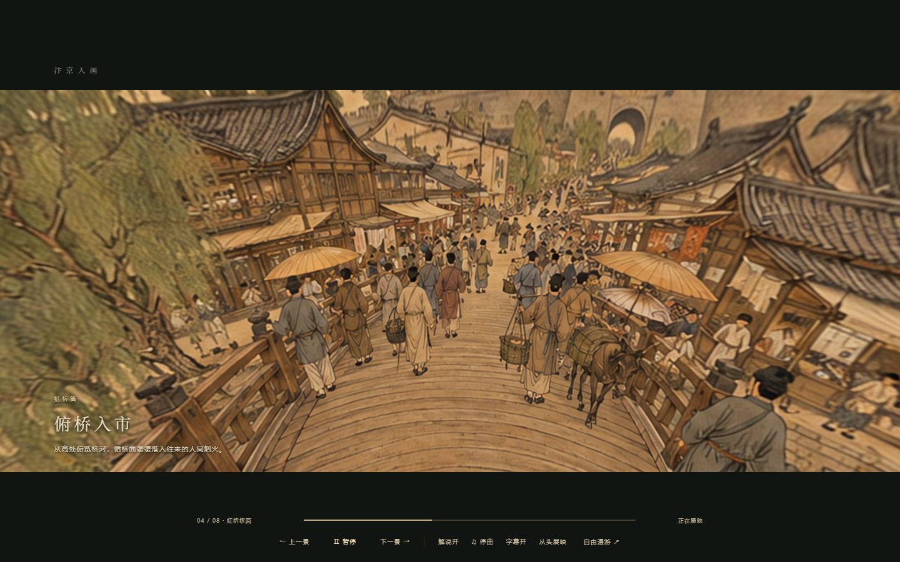
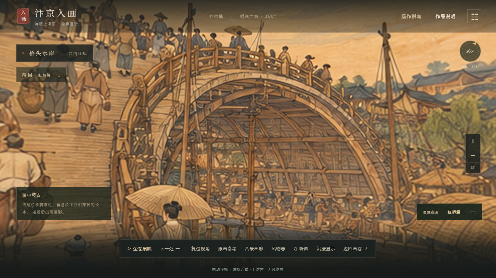
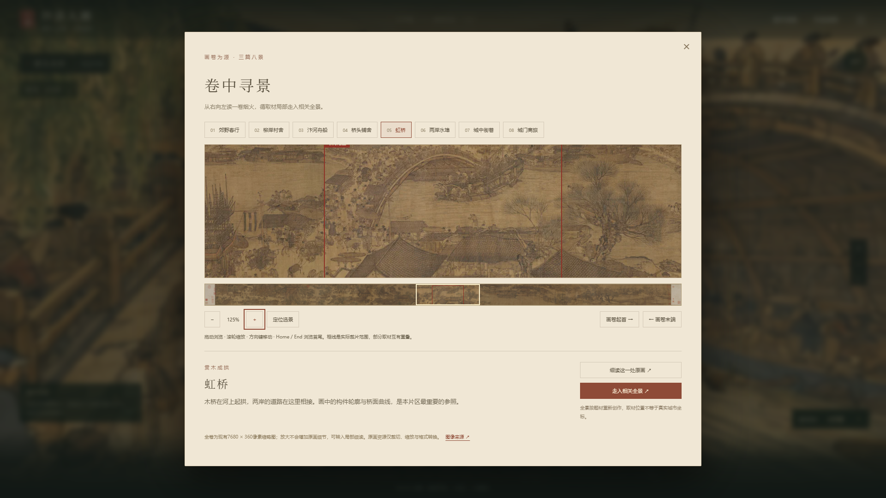
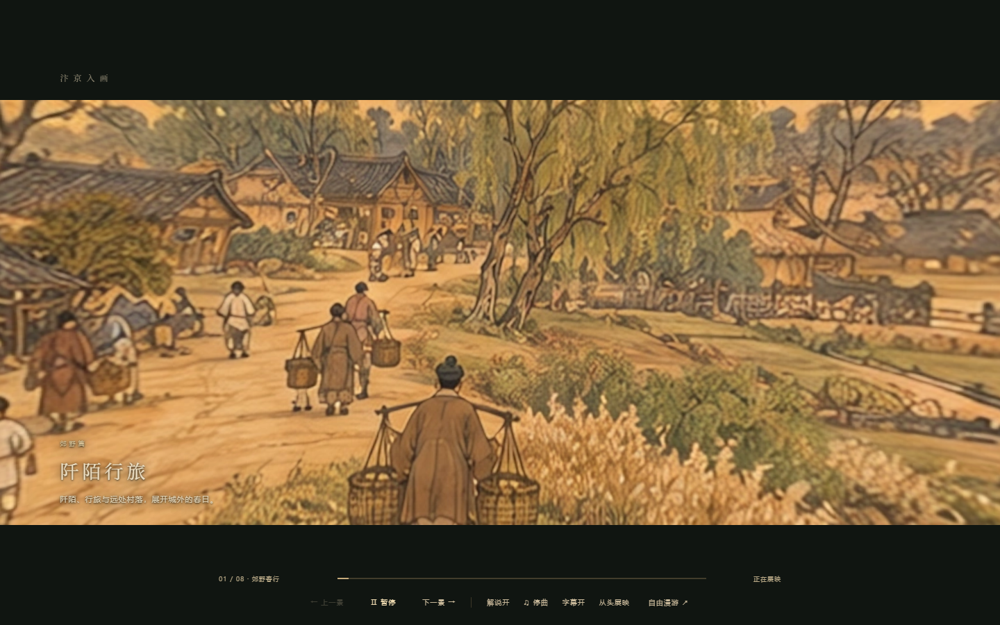
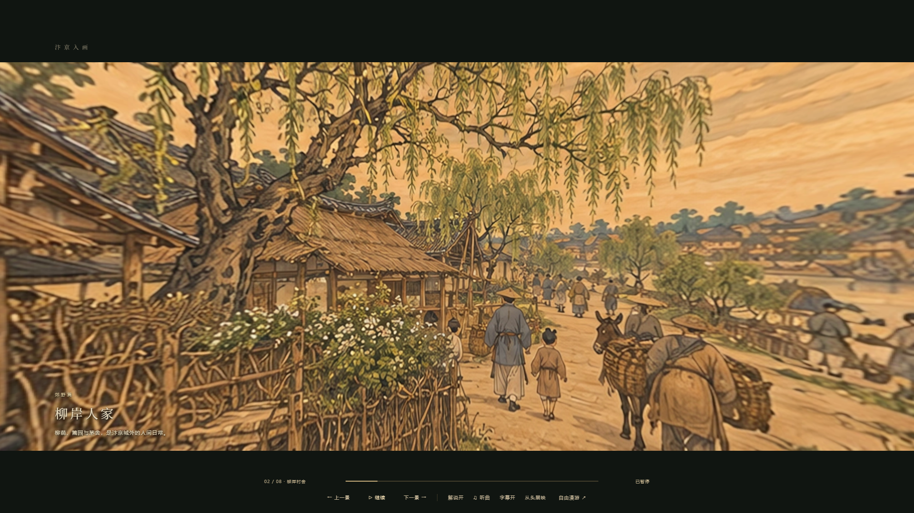
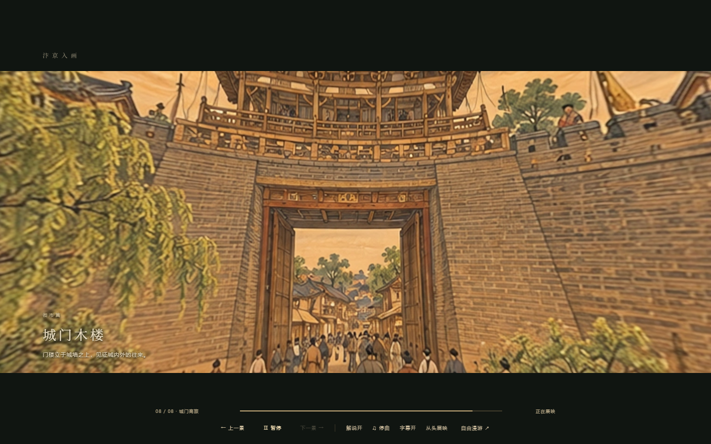

# 汴京入画

以《清明上河图》为灵感的沉浸式网页作品，将郊野、虹桥与城中生活串成一段可以停留、环视和阅读的观画体验。

**八景漫游 · 24镜全卷展映 · 原画对照 · 风物阅读 · 中文解说**

## 完整自动游览视频

**1.28.1 更新版 · 4分21秒 · 9.55MB · 完整八景24镜**

https://github.com/user-attachments/assets/c514f302-d8e7-4ba4-83a0-4197655b241e

直接点击上方播放器观看。若当前客户端只显示视频链接，可打开[完整视频播放页](https://github.com/abalika/bianjing-ruhua-showcase/issues/1)。

采用更新后的统一B音色与透明字幕，原速浏览器实录，包含八段中文解说和古琴配乐，从开场录至收卷；没有加速或删减导览。网页播放版为960×540、20fps，保留原程序进度条与控制栏。为满足10MB以内的体积限制，画质较高清版有所压缩。

[下载1600×900高清版](https://github.com/abalika/bianjing-ruhua-showcase/releases/download/showcase-v1.28.1/bianjing-ruhua-v1.28.1-hd.mp4) · [下载网页播放版及查看文件校验](https://github.com/abalika/bianjing-ruhua-showcase/releases/tag/showcase-v1.28.1) · [旧1.28视频](https://github.com/abalika/bianjing-ruhua-showcase/releases/tag/showcase-v1.28)

视频只展示作品，不能作为可运行程序使用。来源与配乐署名见[CREDITS.md](CREDITS.md)。

## 作品体验

从郊野到虹桥，再到城中，沿三篇八景观看不同生活场景。可以拖动环视、滚轮调整视野，使用 WASD 做有限范围步移，也可以暂停操作，让全卷展映带着视线前行。

自动展映为八景编排24个镜头。解说、字幕与古琴配乐独立控制，手动接管时暂停导览，继续观看时从当前进度衔接。风物阅读围绕器物、营造和市井生活展开；原画参考与“卷中寻景”让全景体验可以回到画卷本身。

本页视频展示2026年10月的1.28.1预览，以下截图保留1.28版本实际界面；本仓库提供作品截图与实际播放录制视频，源码及可运行程序包未公开。

## 自由观景

鼠标环视与有限步移结合节点切景，保留主动探索和暂停阅读的空间。

## 回到原画

全卷定位、局部细读与并排比较，用来观察原画取材位置及局部细节。图中框线表示取材范围，不是历史城市坐标。

## 三篇八景

## 实现概览

- TypeScript、Three.js与WebGL2构成电脑网页体验。
- 360°全景、离线估计的相对深度与节点过渡构成有限视差空间。
- 按需预载与场景缓存控制资源使用，静止时停止重复绘制。
- 原画阅读、历史内容、相机运动、字幕和音频共同组织观画过程。
- AI辅助图像、深度和语音制作在离线阶段完成，网页不加载模型权重。

全景是受原画启发的艺术化补景，包含AI辅助制作内容，并非原画每个对象的精确三维重建，也不是实测古城或完整自由行走地图。当前作品面向电脑浏览；本页在手机上可以查看截图。

## 来源与权利

原画参考、AI辅助制作及第三方工具说明见[来源与制作说明](CREDITS.md)。本仓库公开的是展示资料，不是开放项目源码；权利说明见[COPYRIGHT.md](COPYRIGHT.md)。

作品维护：[abalika](https://github.com/abalika)
